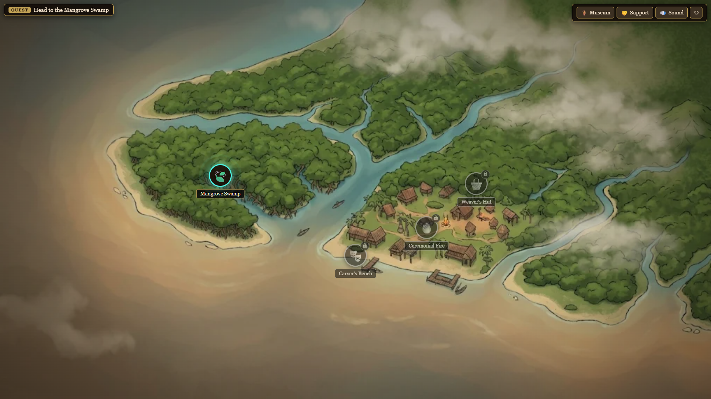
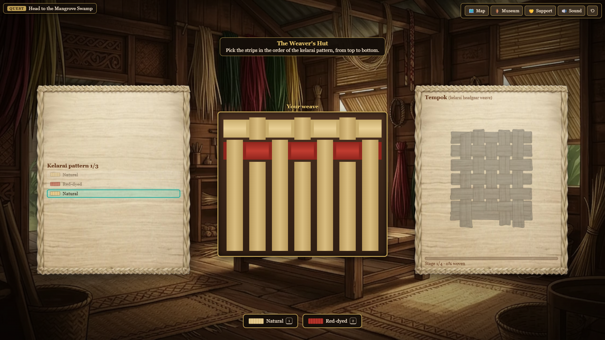
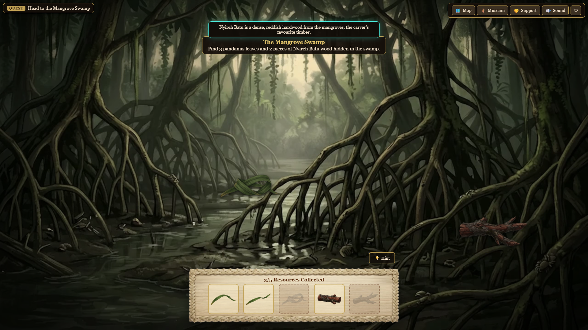
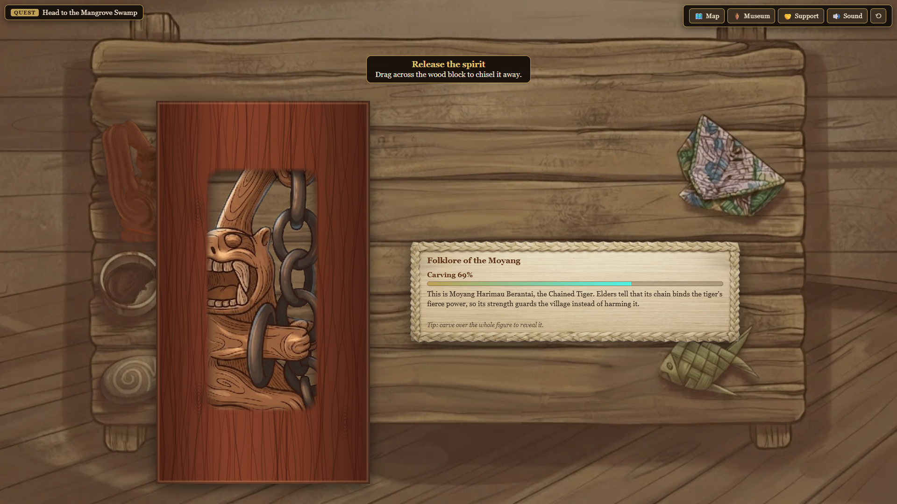
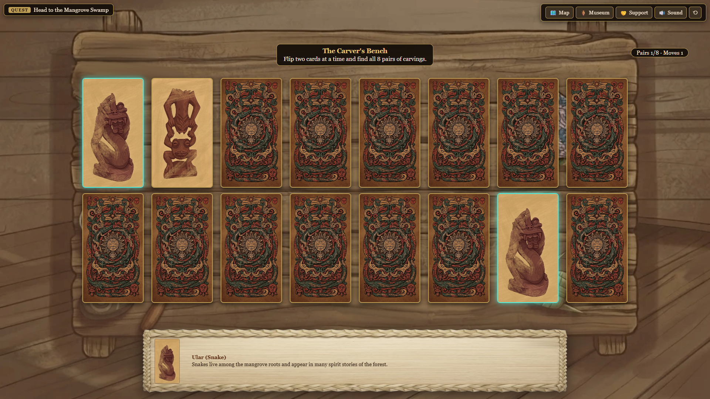
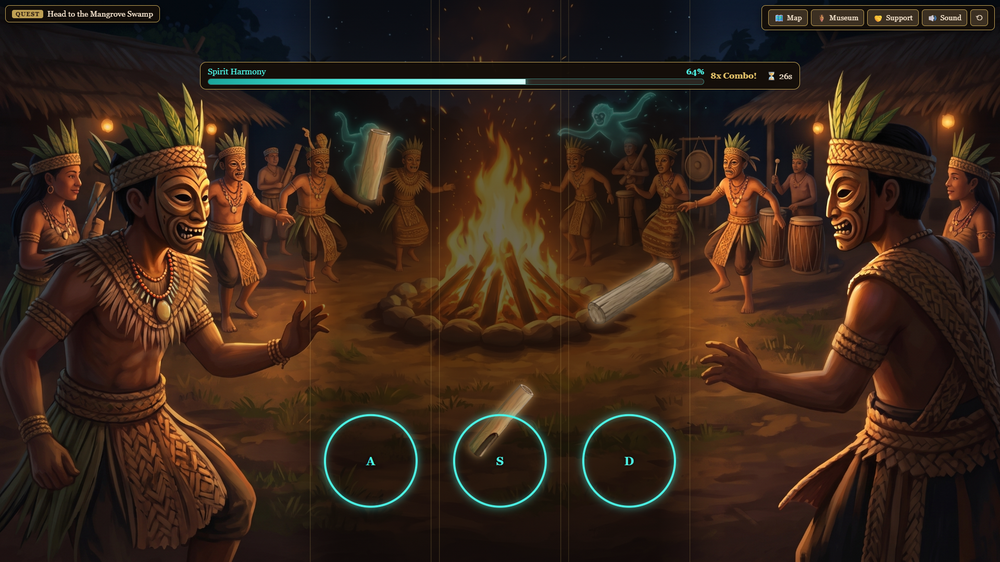
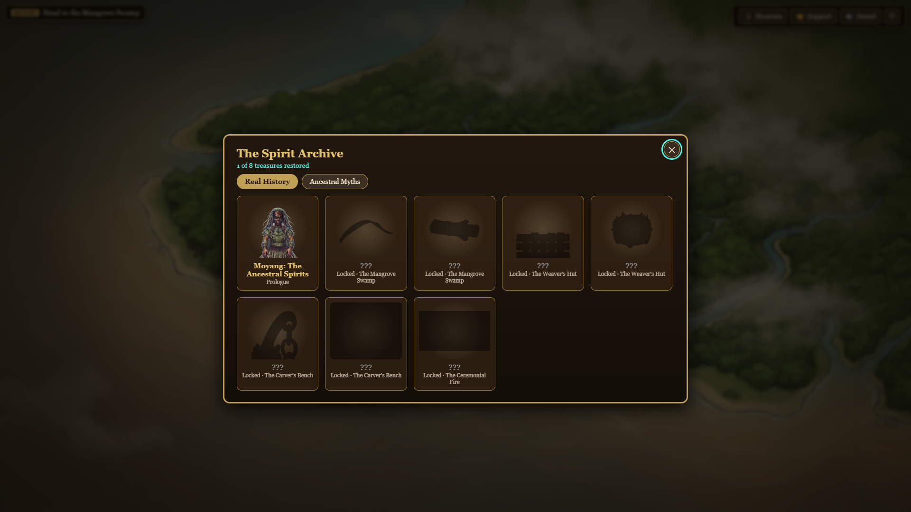

<div align="center">

# 🎭 Spirit of the Mangroves
### *A Gamified Cultural Preservation Journey with the Mah Meri People*

<p align="center">
  <a href="LICENSE"></a>
  
  
  
  
  
</p>

<p align="center">
  <b>An interactive, single-page web adventure exploring the ancestral heritage, woodcraft, and folklore of the indigenous Mah Meri community of Pulau Carey, Malaysia.</b>
</p>

<p align="center">
  <a href="#-overview">Overview</a> •
  <a href="#-the-four-acts">The 4 Acts</a> •
  <a href="#-visual-tour">Visual Tour</a> •
  <a href="#-technical-highlights">Tech Stack</a> •
  <a href="#-quick-start">Quick Start</a> •
  <a href="#-controls--navigation">Controls</a> •
  <a href="#-community--sulam-collaboration">Community Partner</a>
</p>

<br>



</div>

<br>

---

## 🌿 Overview

**Spirit of the Mangroves** was developed as part of a Service Learning Malaysia (SULAM) initiative in collaboration with the **Mah Meri Cultural Village (MMCV)** in Pulau Carey, Selangor.

The Mah Meri (*"People of the Sea"*) are one of the 18 indigenous Orang Asli groups in Peninsular Malaysia, celebrated worldwide for their intricate pandanus weaving and expressive mangrove wood carvings. 

In this journey, players are guided by **Moyang Tok Naning**, an ancestral spirit, across four sacred sites of Pulau Carey. To prepare for the annual **Hari Moyang** (Ancestor's Day) festival, the player must gather raw materials from the tides, weave ceremonial headpieces, chisel sacred masks from timber, and perform the ancestral *Tarian Jo'oh* dance.

---

## 🎮 The Four Acts

<table width="100%">
  <tr>
    <td width="50%" valign="top">
      <h3>🍃 Act I: The Mangrove Swamp</h3>
      <p><b>Gathering the Sacred Elements</b></p>
      <ul>
        <li><b>Objective:</b> Search the coastal mangrove roots for 3 pandanus leaves and 2 pieces of rare <i>Nyireh Batu</i> driftwood.</li>
        <li><b>Mechanic:</b> Hidden-object discovery with floating resource tracking and real-time cultural trivia cards.</li>
      </ul>
    </td>
    <td width="50%" valign="top">
      <h3>🧺 Act II: The Weaver's Hut</h3>
      <p><b>Kelarai Pattern Weaving</b></p>
      <ul>
        <li><b>Objective:</b> Weave the traditional <i>Tempok</i> headgear and <i>Sungu</i> thorned basket.</li>
        <li><b>Mechanic:</b> Pattern memory and rhythm selection matching natural, red-dyed, and dark pandanus strips on an interactive loom.</li>
      </ul>
    </td>
  </tr>
  <tr>
    <td width="50%" valign="top">
      <h3>🎭 Act III: The Carver's Bench</h3>
      <p><b>Memory Match & Sacred Chisel</b></p>
      <ul>
        <li><b>Objective:</b> Pair 8 traditional Mah Meri carving motifs, then chisel away the raw block to reveal <i>Moyang Harimau Berantai</i> (The Chained Tiger).</li>
        <li><b>Mechanic:</b> 16-card matching followed by interactive 2D canvas pixel chiseling with dynamic wood-grain physics and milestone lore unlocks.</li>
      </ul>
    </td>
    <td width="50%" valign="top">
      <h3>🔥 Act IV: The Ceremonial Fire</h3>
      <p><b>Tarian Jo'oh Rhythm Finale</b></p>
      <ul>
        <li><b>Objective:</b> Accompany the village dancers around the sacred fire to achieve 100% Spirit Harmony.</li>
        <li><b>Mechanic:</b> 3-lane vertical rhythm engine timed to bamboo <i>tuntung</i> stampers, gong strikes, and combo-based harmony multipliers.</li>
      </ul>
    </td>
  </tr>
</table>

---

## 📸 Visual Tour

### 1. Interactive Loom Weaving & Resource Gathering
<table width="100%">
  <tr>
    <td width="50%" align="center">
      
      <p><i>Selecting dyed strips and weaving the Kelarai pattern on the loom</i></p>
    </td>
    <td width="50%" align="center">
      
      <p><i>Collecting Pandanus and Nyireh Batu wood hidden in the tidal roots</i></p>
    </td>
  </tr>
</table>

### 2. Wood Chiseling & Tile Matching
<table width="100%">
  <tr>
    <td width="50%" align="center">
      
      <p><i>Procedurally chiseling the wood block to release Moyang Harimau Berantai</i></p>
    </td>
    <td width="50%" align="center">
      
      <p><i>Matching sacred motifs and discovering ancestral folklore</i></p>
    </td>
  </tr>
</table>

### 3. Tarian Jo'oh Rhythm Finale & Cultural Archive
<table width="100%">
  <tr>
    <td width="50%" align="center">
      
      <p><i>Tarian Jo'oh rhythm dance with bamboo tuntung strikes and combo multipliers</i></p>
    </td>
    <td width="50%" align="center">
      
      <p><i>The Spirit Archive: Curated oral history and verified ancestral myths</i></p>
    </td>
  </tr>
</table>

---

## ⚡ Technical Highlights

- **Zero-Dependency Architecture:** Pure Vanilla JavaScript (ES6+), semantic HTML5, and CSS custom properties (`var(--teal)`, `var(--gold)`, container queries). No bundlers, npm packages, or external frameworks required.
- **Canvas Pixel Alpha Masking:** Act III's wood chiseling calculates remaining opacity in real-time (`getImageData` sampled at 5px grid intervals) against `destination-out` radial chisel paths.
- **Synthesized Web Audio Engine:** Fully procedural audio synthesizer fallback for clicks, flips, river ambience, wood chips, and *tuntung* beats without relying on heavy external audio files.
- **Transient Network Self-Healing:** Dynamic asset loader equipped with exponential backoff auto-retries for high stability on local development servers.
- **State Persistence:** Local storage engine tracking completed acts, unlocked lore, best rhythm combos, and audio preferences.

---

## 🚀 Quick Start

### Option 1: Python HTTP Server (Recommended)
No installation required. Run directly from your terminal:

```bash
# Python (Windows: py, macOS/Linux: python3)
py -m http.server 8000
# or Node
# Windows
python -m http.server 8000

# macOS / Linux
python3 -m http.server 8000
```
Then navigate to **`http://localhost:8000`** in any modern web browser.

### Option 2: Node.js `npx serve`
```bash
npx serve .
```

Then open http://localhost:8000.
> [!NOTE]
> Running through a local HTTP server is recommended rather than opening `index.html` via `file://`, as the Act III wood carving engine inspects canvas pixel alpha buffers for progress milestones.

Opening `index.html` directly also works. Serving it over http is recommended, because the Act III carving progress uses canvas pixel data.
---

### Testing shortcuts
- `?screen=map`, `?screen=act1` … `?screen=act4`, `?screen=museum`, `?screen=portal` jump straight to a screen.
- The ⟲ button in the top bar resets progress.
- `App.launchMiniGame(3)` in the browser console opens an act.
## 🕹️ Controls & Navigation

## Project structure
| Screen / Act | Keyboard Shortcut | Mouse / Touch Gesture |
| :--- | :--- | :--- |
| **All Screens** | `Escape` to close modals | Click UI buttons / HUD controls |
| **Moyang Dialogue** | `Space` or `Enter` to advance | Tap text box or click "Next" / "Skip" |
| **Act II (Weaving)** | `1`, `2`, `3` to pick strip color | Tap strip swatches at the bottom |
| **Act III (Chisel)** | Click & drag cursor | Touch and drag across the wood canvas |
| **Act IV (Dance)** | `A`, `S`, `D` *(or `J`, `K`, `L` / `←`, `↓`, `→`)* | Tap the 3 glowing lane strike rings |

### 🔍 Developer & QA Jump Shortcuts
Jump directly to any section using URL query parameters:
- Island Map: `http://localhost:8000/?screen=map`
- Act I (Swamp): `http://localhost:8000/?screen=act1`
- Act II (Loom): `http://localhost:8000/?screen=act2`
- Act III (Cards): `http://localhost:8000/?screen=act3`
- Act III (Chisel): `http://localhost:8000/?screen=act3_chisel`
- Act IV (Dance): `http://localhost:8000/?screen=act4`
- Spirit Archive: `http://localhost:8000/?screen=museum`
- Artisan Portal: `http://localhost:8000/?screen=portal`

---

## 📂 Project Structure

```text
Mah_Meri_Gamified_Website/
├── slide/                      # SULAM proposal interactive presentation deck & assets
├── screenshots/                # 1080p high-resolution UI and in-action gameplay captures
│   └── gameplay_action/        # Detailed captures of mini-games in mid-play
├── assets/                     # Core multimedia assets
│   ├── cutscenes/              # Video cutscenes (intro & act endings)
│   ├── audio/                  # Audio recordings and ambient sound
│   └── images/                 # Sprites, backgrounds, maps, and motifs
├── css/
│   └── styles.css              # Earth & spirit aesthetic stylesheet
├── js/
│   ├── assets.js               # Asset path directory & encoding
│   ├── audio.js                # Web Audio synthesizer & sound manager
│   ├── content.js              # Cultural lore, dialogue, cards, and trivia
│   ├── dialogue.js             # Typewriter spirit dialogue engine
│   ├── display.js              # Phone full screen + rotate-your-phone notice
│   ├── main.js                 # View router, HUD, and QA shortcuts
│   ├── state.js                # LocalStorage progress save system
│   ├── ui.js                   # Particles, floating text, and auto-retry helpers
│   └── games/
│       ├── act1-gather.js      # Act I hidden-object mechanics
│       ├── act2-weave.js       # Act II Kelarai weaving loom
│       ├── act3-carve.js       # Act III card match & canvas chisel
│       └── act4-rhythm.js      # Act IV Tarian Jo'oh rhythm engine
├── index.html                  # Main application shell
└── README.md                   # Project documentation
```
index.html                 page shell: title, map, game stage, dialogue, museum, portal
css/styles.css             all styling (earthy palette + teal/gold spirit UI)
js/assets.js               every image/video path (keep exact .PNG/.png case for Linux hosting)
js/content.js              all text: dialogue, folklore, card notes, museum entries, portal links
js/state.js                progress + localStorage save
js/audio.js                Web Audio synth SFX/ambience (map real mp3s via AudioFX.files)
js/ui.js                   shared helpers (toast, floating text, particles, result panel)
js/dialogue.js             Moyang typewriter dialogue
js/display.js              phone full screen (landscape) + rotate notice (portrait)
js/games/act1-gather.js    Act I
js/games/act2-weave.js     Act II
js/games/act3-carve.js     Act III
js/games/act4-rhythm.js    Act IV
js/main.js                 router, map, HUD, act flow, museum, portal
```

Each mini-game exposes `window.Games[n] = { mount(container, { onComplete }), unmount() }`.
---

## Content TODO (Member 3)
- Verify the cultural accuracy of the lines marked "verify" in `js/content.js`.
- Replace the search/maps links in the portal with official artisan, tour and NGO links.
- Add photos of real Mah Meri artisans to the Spirit Archive.
- Optional: drop recorded audio into `assets/audio/` and map it in `AudioFX.files`.
## 🤝 Community & SULAM Collaboration

- **Institution:** Universiti Malaya (Faculty of Computer Science & Information Technology)
- **Course:** WIX2001 Service Learning Malaysia (SULAM)
- **Team:** OCC3 Group 3
- **Community Partner:** Mah Meri Cultural Village (MMCV), Pulau Carey, Selangor
- **Course Coordinator / Lecturer:** Madam Mas Idayu binti Md Sabri

### Authentic Artisan Support
The in-game **Support the Artisans** portal connects visitors directly to MMCV cultural workshops, guided mangrove trails, and authorized craft cooperatives to ensure sustainable economic impact for the Mah Meri community.

---

## 📄 License

Distributed under the **MIT License**. See [`LICENSE`](LICENSE) for details.
All cultural motifs, stories, and photographs are showcased with respect and reverence to the heritage of the Mah Meri people of Pulau Carey.
